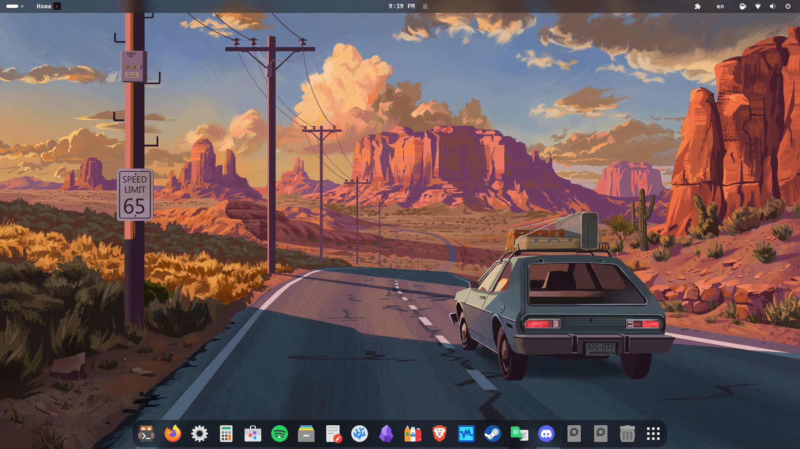
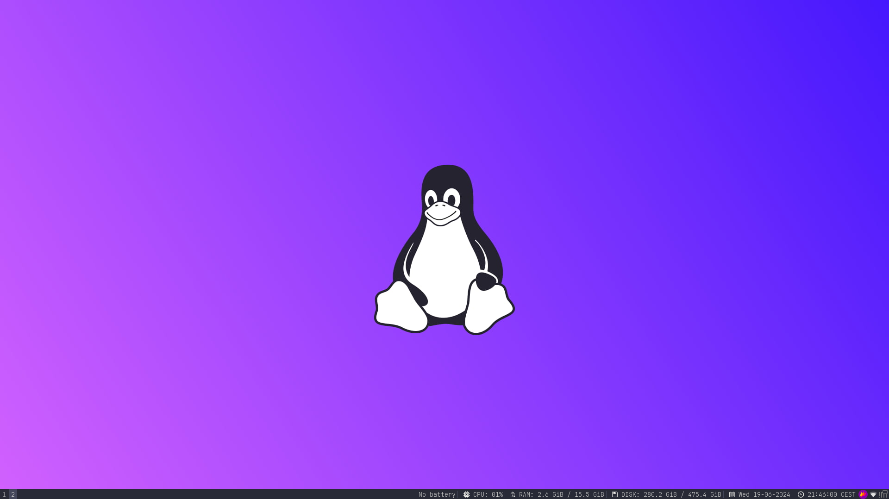
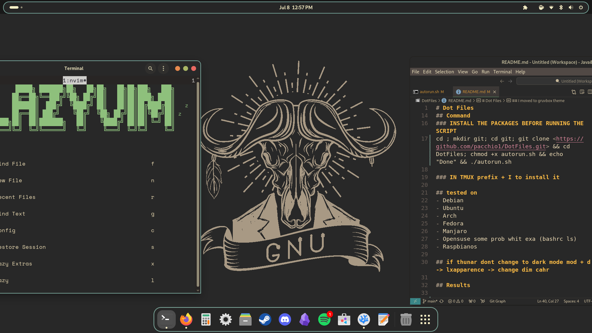

# Dot Files
DotFiles, my config files

## Pacchetti
git neovim neofetch tmux bat fzf exa fish locate

### I3 customization
i3 i3status i3status nitrogen thunar flameshot blueman  pavucontrol lxappearance
#### sometimes I rice with: pulseaudio NetworkManager

### USED - not needed
[vscodeium](https://vscodium.com/) npm([Debian last version](https://deb.nodesource.com/)) angular [lazygit](https://github.com/jesseduffield/lazygit) ranger(cli file manager) apropos(man-db)

## Command

### INSTALL THE PACKAGES BEFORE RUNNING THE SCRIPT
cd ; mkdir git; cd git; git clone <https://github.com/pacchio1/DotFiles.git> && cd DotFiles; chmod +x autorun.sh && echo "Done" && ./autorun.sh

### IN TMUX prefix + I to install it

## tested on
- Debian
- Ubuntu
- Arch
- Fedora
- Manjaro
- Opensuse some prob whit exa (bashrc ls)
- Raspbianos

## if thunar dont change to dark mode mod + d -> lxapparence -> change dim cahr

## Results





## I moved to gruvbox theme



## Script Disponibili

### scripts/
- `riordina.sh` — Ordina i file per tipo in cartelle (Pictures, Downloads, Documents, Videos, Music)
- `riordina.php` — Versione PHP di riordina.sh
- `flatpak_install.sh` — Installa app Flatpak selezionate da Flathub
- `toggle_kvm.sh` — Attiva/disattiva moduli KVM per virtualizzazione
- `video_analisi.sh` — Estrae trascript e analizza video con Ollama/Fabric
- `tmuxifier+vide.sh` — Setup sessione tmux con tmuxifier
- `java_angular-setup_script.sh` — Setup ambiente Java/Angular con SDKMAN
- `spegni.sh` — Spegnimento confermato del computer

### bashrc/
- `daily.sh` — Configurazione bash quotidiana (alias, prompt, plugin)
- `.bash_aliases` — Alias personalizzati

## Struttura dei File

```
DotFiles/
├── .config/           # Configurazioni applicativi (i3, ghostty, neovim, opencode, terminator)
├── .local/share/fonts/ # Font personalizzati
├── .tmux.conf         # Configurazione tmux
├── .gitconfig         # Configurazione git
├── .gitignore         # File ignorati da git
├── autorun.sh         # Script di installazione principale
├── bashrc/            # Configurazioni bash
├── scripts/           # Script vari
├── customization/     # Preset EasyEffects
├── other/             # Documentazione e screenshot
├── audio_fix.txt      # Note fix audio Bluetooth
├── todo.md            # TODO personale
└── README.md
```

## Fix Applicati

- Corretto typo in `autorun.sh` (`thouch` → `touch`, `eccho` → `echo`)
- Sostituiti tutti i path hardcoded `/home/mark/` con `$HOME`
- Rimosso `credential.helper = store` in favore di `cache` per sicurezza
- Aggiunto `set -euo pipefail` agli script
- Consolidate le 4 funzioni `ask_confirmation*` in un'unica funzione parametrizzata
- Corretto typo `firefoxhttps://` in i3 config
- Rimosso duplicato `tar` nel case statement di `riordina.sh`
- Aggiornato `riordina.php` con estensioni `tar.xz`, `tgz`, `xz`

## Sicurezza

- Credenziali git gestite con `credential.helper = cache` (timeout 3600s) invece di `store`
- Nessun dato sensibile committato nel repository
- `.gitignore` esclude `node_modules`, `.themes`, `.icons`

## Contributing

1. Fai le modifiche su una nuova branch
2. Testa gli script prima di commitare
3. Aggiorna la documentazione se necessario
4. Usa messaggi di commit descrittivi

## License

Questo progetto è distribuito senza license.

